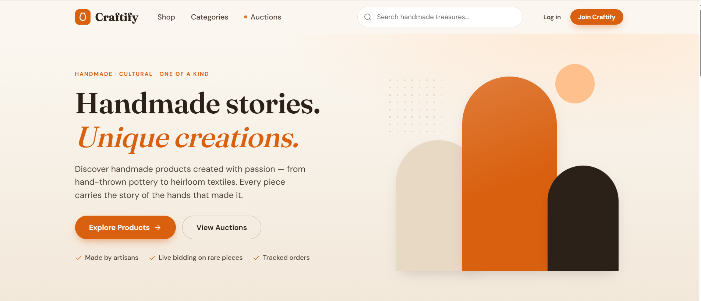
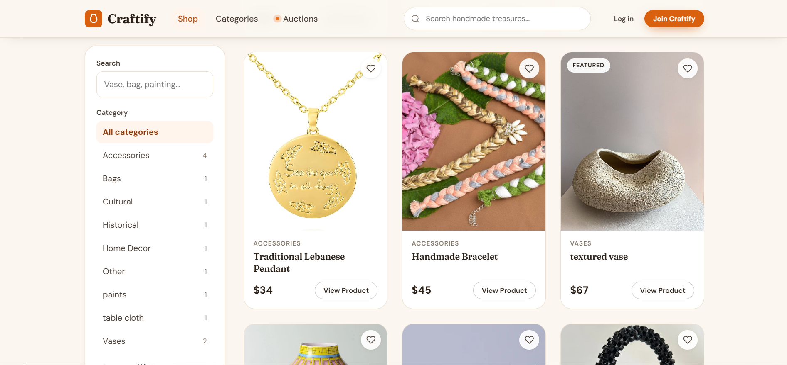
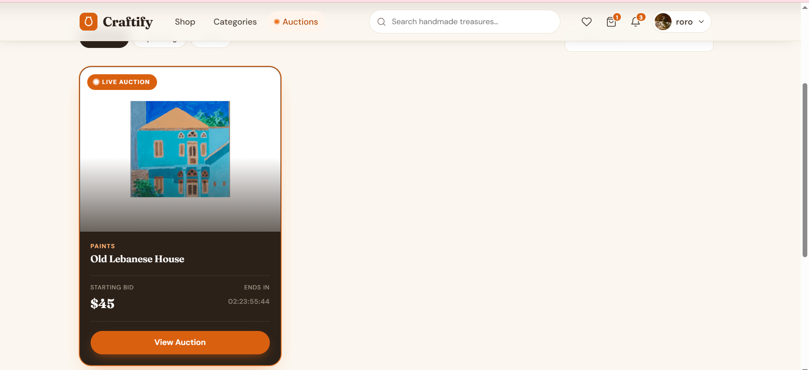
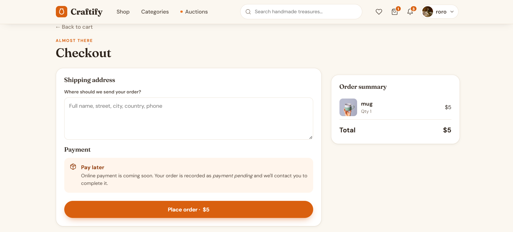
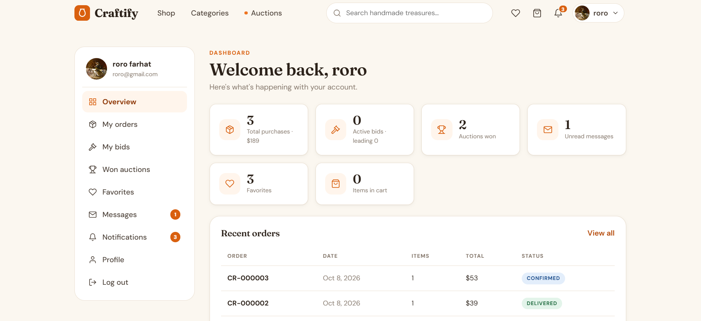
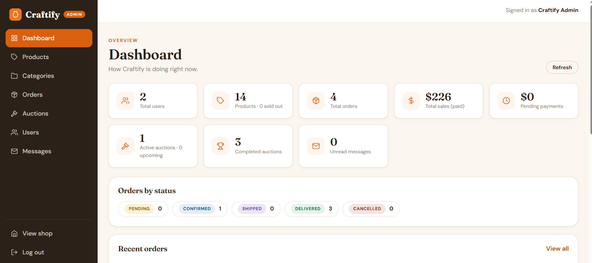

# Craftify

**A full-stack marketplace and live-auction platform for handmade and culturally inspired products.**

Customers can browse and buy handmade goods, or bid on one-of-a-kind pieces in timed auctions. A single administrator runs the whole platform: catalog, orders, auctions, users and messaging.


> **Status:** portfolio project. It runs locally (setup below). Payment is a placeholder: there is no payment gateway yet.

---

## Screenshots

<!-- Add your images to docs/screenshots and keep these file names, or edit the paths. -->

| Home | Shop with filters |
|---|---|
|  |  |

| Live auction | Checkout |
|---|---|
|  |  |

| Customer dashboard | Admin panel |
|---|---|
|  |  |

<!-- Optional: [Watch the 2-minute demo](https://youtube.com/your-unlisted-video) -->

---

## Features

### For customers
- Browse, search, filter (category, price range, featured) and sort products, with pagination. Filters live in the URL, so any search can be shared or bookmarked.
- Product pages with an image gallery, stock status, favorites and related items.
- Shopping cart with live stock checks, then checkout that records the order.
- **Live auctions:** a real-time countdown, bidding, outbid warnings, full bid history, and automatic result when the timer ends.
- Customer dashboard: overview stats, orders (with cancellation), bids and standing, won auctions (with shipping address), favorites, messages and notifications.
- Profile management: details, photo upload and password change.

### For the administrator
- Dashboard with users, products, orders, sales, auction counts and recent activity.
- Product management with multi-image upload, main-image selection, and enable/disable and featured toggles.
- Category management.
- Order management with a validated status workflow: `PENDING → CONFIRMED → SHIPPED → DELIVERED` (or `CANCELLED`) and payment tracking.
- Auction management: create, edit, cancel, end early, delete (only if no bids), and view every bidder and bid.
- User management: search, view orders and auction activity, activate or deactivate accounts.
- Messaging: write to one customer, or announce to all active users.

---

## How the auction system works

This is the core of the project. The browser is never trusted to decide anything.

- **Server-side timing.** Every bid is checked against the **database clock**: the auction must have started and not ended. The countdown in Angular is display only, and it follows the server's clock rather than the visitor's.
- **Race-safe bidding.** A bid runs in a transaction that first locks the auction row (`SELECT … FOR UPDATE`). Simultaneous bids are processed one at a time, so two users can never both become the highest bidder.
- **Bid rules.** The amount must be at least the starting price for the first bid and strictly higher than the current bid after that. A user cannot outbid themselves, and the administrator cannot bid.
- **Automatic settlement.** A background scheduler closes expired auctions. In one transaction it picks the highest bid as the winner, creates the winner's order, sends a congratulations message and notification, and notifies the other bidders. A unique constraint guarantees one order per auction even if settlement ever ran twice.
- **Lazy settlement.** Viewing or bidding on an auction whose time has just run out also settles it, so users never see a stale state.

---

## Tech stack

| Layer | Technology |
|---|---|
| Frontend | Angular 9.0.0, TypeScript 3.7, RxJS, Angular Material, SCSS (custom design system), reactive forms |
| Backend | Node.js 24, Express, TypeScript, `mysql2`, `zod` (validation), `multer` (uploads), `helmet`, `cors` |
| Auth | JWT, `bcrypt` password hashing, role-based access control |
| Database | MySQL 8, 12 tables with foreign keys, indexes and constraints |
| Testing | 91 automated end-to-end API checks (`backend/tests/smoke.mjs`) |

### Architecture

```
Angular 9 (SPA)  ──HTTP/JSON──▶  Express API (TypeScript)  ──SQL──▶  MySQL 8
lazy-loaded modules              controllers → services → models      transactions,
guards, interceptors             JWT auth, validation                 row-level locking
```

### Project structure

```
craftify/
├── backend/
│   ├── database/schema.sql      12-table schema with seed categories
│   ├── src/
│   │   ├── config/              env + MySQL pool, transaction helper
│   │   ├── controllers/         thin HTTP handlers
│   │   ├── middleware/          auth, admin guard, validation, uploads, error handler
│   │   ├── models/              SQL queries
│   │   ├── routes/              REST routes
│   │   ├── services/            business logic: auctions, orders, messages, scheduler
│   │   └── scripts/seedAdmin.ts creates the single admin account
│   └── tests/smoke.mjs          end-to-end API test suite
└── frontend/
    └── src/app/
        ├── core/                models, API services, interceptors, guards
        ├── shared/              reusable components and pipes
        ├── layout/              header and footer
        ├── auth/ home/ products/ categories/ auctions/ cart/ checkout/
        ├── dashboard/           customer area
        └── admin/               admin panel
```

### Security
- Passwords hashed with bcrypt, and JWT-protected routes.
- Admin-only routes enforced on the server. Frontend guards are only a convenience.
- Exactly one administrator, guaranteed by a database constraint and not creatable through the UI or API.
- Parameterized SQL everywhere, request validation with `zod`, and `helmet` plus a restricted CORS origin.
- Secrets live in `.env` and are never committed.
- Deactivating a user cuts off access immediately, because every request re-checks the account.

---

## Getting started

### Prerequisites
- **MySQL 8.0+**
- **Node 24.11.1** for the backend
- **Node 13.11.0** for the frontend (Angular 9). Use [nvm](https://github.com/nvm-sh/nvm) (or nvm-windows) to switch between them.

### 1. Database
```bash
mysql -u root -p < backend/database/schema.sql
```
Or open `backend/database/schema.sql` in MySQL Workbench and run it.

### 2. Backend
```bash
cd backend
cp .env.example .env        # Windows: copy .env.example .env
```
Edit `.env` and set the values below.

| Variable | Meaning |
|---|---|
| `DB_HOST`, `DB_PORT`, `DB_USER`, `DB_PASSWORD`, `DB_NAME` | Your MySQL connection (`DB_NAME=craftify`) |
| `JWT_SECRET` | A long random string |
| `CORS_ORIGIN` | Frontend URL, `http://localhost:4200` locally |
| `ADMIN_EMAIL`, `ADMIN_PASSWORD` | Credentials for the single admin account |

```bash
nvm use 24.11.1
npm install
npm run seed:admin          # creates the one admin account
npm run dev                 # http://localhost:3000/api
```

### 3. Frontend (separate terminal)
```bash
cd frontend
nvm use 13.11.0
npm install
npm start                   # http://localhost:4200
```

- Shop: <http://localhost:4200>
- Admin panel: <http://localhost:4200/admin/login> (use the `ADMIN_EMAIL` and `ADMIN_PASSWORD` from `.env`)
- API base URL: `frontend/src/environments/environment.ts`

### Run the tests
With a **fresh database** and the backend running:
```bash
cd backend
node tests/smoke.mjs        # Node 18+
```
The suite creates test users, products and auctions, so don't run it against real data.

---

## API overview

REST API under `/api`. Responses use `{ "success": true, "data": … }` or `{ "success": false, "message": … }`.

| Area | Endpoints |
|---|---|
| Auth | `POST /auth/register`, `POST /auth/login`, `POST /auth/admin/login`, `GET /auth/me` |
| Catalog | `/products`, `/categories` (public reads, admin writes with image upload) |
| Shopping | `/cart`, `/favorites`, `/orders` (checkout, status, cancel) |
| Auctions | `/auctions`, `POST /auctions/:id/bids`, `GET /auctions/:id/bids` |
| Account | `/users/me` (profile, avatar, password, overview, bids, won auctions) |
| Messaging | `/messages`, `/notifications` |
| Admin | `/admin/overview`, `/users` (customer management) |

---

## Known limitations and roadmap
- No payment gateway yet. Orders are marked `PENDING` or `PAID` manually. Stripe is the next step.
- Product images are stored on the server's local disk. For production, move them to object storage such as S3 or Cloudinary.
- JWTs are stateless (7-day expiry) and cannot be revoked individually.
- The auction scheduler runs inside the API process, which is fine for one instance. Multiple instances stay correct thanks to row locking, but a dedicated job runner would be cleaner.
- Angular 9 is end-of-life. A natural next step is upgrading to a current Angular version.

---

## Author

Built by **Fatima farhat**: [GitHub](https://github.com/Fatima-farhat1) · [LinkedIn](https://www.linkedin.com/in/fatima-farhat-37b622417?utm_source=share_via&utm_content=profile&utm_medium=member_android)
